# Diagrama actualizado de Gymbro

Esquema PostgreSQL: `gymbro`. Generado desde los modelos Sequelize actuales, más la tabla técnica `migraciones_esquema`. Representa el esquema esperado tras aplicar las migraciones; no inspecciona ni modifica Supabase.

16 tablas, 19 claves foráneas. PK = clave primaria, FK = clave foránea, UK = unicidad de una columna. Las líneas punteadas representan relaciones no identificadoras. Un círculo permite cero; una barra indica uno; el extremo ramificado indica muchos.

## Vista completa

```mermaid
erDiagram
  direction LR
  usuarios {
    uuid id PK "UUID; NOT NULL"
    varchar correo_electronico UK "VARCHAR(255); NOT NULL"
    varchar hash_contrasena "VARCHAR(255); NOT NULL"
    timestamptz inicio_semana_ia "TIMESTAMP WITH TIME ZONE; NULL"
    integer generaciones_ia_semana "INTEGER; NOT NULL"
    timestamptz fecha_cambio_contrasena "TIMESTAMP WITH TIME ZONE; NULL"
    varchar nombre "VARCHAR(255); NOT NULL"
    varchar objetivo "VARCHAR(255); NULL"
    integer altura_cm "INTEGER; NULL"
    varchar nombre_gimnasio "VARCHAR(255); NULL"
    varchar disciplina "VARCHAR(255); NULL"
    text foto_url "TEXT; NULL"
    boolean participa_ranking "BOOLEAN; NOT NULL"
    timestamptz fecha_creacion "TIMESTAMP WITH TIME ZONE; NOT NULL"
    timestamptz fecha_actualizacion "TIMESTAMP WITH TIME ZONE; NOT NULL"
    timestamptz fecha_eliminacion "TIMESTAMP WITH TIME ZONE; NULL"
  }
  consentimientos_legales {
    uuid id PK "UUID; NOT NULL"
    varchar version "VARCHAR(80); NOT NULL"
    varchar hash_documento "VARCHAR(64); NOT NULL"
    jsonb documentos "JSONB; NOT NULL"
    boolean terminos_aceptados "BOOLEAN; NOT NULL"
    boolean privacidad_reconocida "BOOLEAN; NOT NULL"
    boolean mayoria_edad_confirmada "BOOLEAN; NOT NULL"
    boolean permiso_datos_deportivos "BOOLEAN; NOT NULL"
    timestamptz fecha_aceptacion "TIMESTAMP WITH TIME ZONE; NOT NULL"
    uuid usuario_id FK "UUID; NOT NULL"
  }
  usuarios ||..o{ consentimientos_legales : "usuario_id"
  dias_descanso_usuario {
    uuid id PK "UUID; NOT NULL"
    integer dia_semana "INTEGER; NOT NULL"
    uuid usuario_id FK "UUID; NOT NULL"
  }
  usuarios ||..o{ dias_descanso_usuario : "usuario_id"
  planes_iniciales {
    uuid id PK "UUID; NOT NULL"
    jsonb preferencias "JSONB; NOT NULL"
    jsonb propuesta "JSONB; NOT NULL"
    varchar origen "VARCHAR(16); NOT NULL"
    timestamptz fecha_aceptacion "TIMESTAMP WITH TIME ZONE; NULL"
    timestamptz fecha_omision "TIMESTAMP WITH TIME ZONE; NULL"
    timestamptz fecha_creacion "TIMESTAMP WITH TIME ZONE; NOT NULL"
    timestamptz fecha_actualizacion "TIMESTAMP WITH TIME ZONE; NOT NULL"
    uuid usuario_id FK, UK "UUID; NOT NULL"
    uuid rutina_id FK "UUID; NULL"
  }
  usuarios ||..o| planes_iniciales : "usuario_id"
  rutinas |o..o{ planes_iniciales : "rutina_id"
  ejercicios {
    uuid id PK "UUID; NOT NULL"
    varchar nombre "VARCHAR(255); NOT NULL"
    varchar nombre_normalizado "VARCHAR(255); NOT NULL"
    varchar grupo_muscular "VARCHAR(255); NOT NULL"
    varchar equipamiento "VARCHAR(255); NOT NULL"
    varchar patron_movimiento "VARCHAR(255); NULL"
    text descripcion "TEXT; NULL"
    text enlace_video "TEXT; NULL"
    varchar tipo_entrenamiento "VARCHAR(255); NOT NULL"
    timestamptz fecha_eliminacion "TIMESTAMP WITH TIME ZONE; NULL"
    uuid creado_por_usuario_id FK "UUID; NULL"
  }
  usuarios |o..o{ ejercicios : "creado_por_usuario_id"
  rutinas {
    uuid id PK "UUID; NOT NULL"
    varchar nombre "VARCHAR(255); NOT NULL"
    varchar objetivo "VARCHAR(255); NOT NULL"
    boolean activa "BOOLEAN; NULL"
    timestamptz fecha_creacion "TIMESTAMP WITH TIME ZONE; NOT NULL"
    timestamptz fecha_eliminacion "TIMESTAMP WITH TIME ZONE; NULL"
    uuid usuario_id FK "UUID; NOT NULL"
  }
  usuarios ||..o{ rutinas : "usuario_id"
  dias_rutina {
    boolean favorita "BOOLEAN; NOT NULL"
    uuid id PK "UUID; NOT NULL"
    varchar nombre "VARCHAR(255); NOT NULL"
    integer numero_dia "INTEGER; NOT NULL"
    timestamptz fecha_eliminacion "TIMESTAMP WITH TIME ZONE; NULL"
    uuid rutina_id FK "UUID; NOT NULL"
  }
  rutinas ||..o{ dias_rutina : "rutina_id"
  ejercicios_rutina {
    uuid id PK "UUID; NOT NULL"
    integer orden "INTEGER; NOT NULL"
    integer series_objetivo "INTEGER; NOT NULL"
    integer repeticiones_minimas "INTEGER; NOT NULL"
    integer repeticiones_maximas "INTEGER; NOT NULL"
    integer descanso_segundos "INTEGER; NULL"
    integer duracion_objetivo_minutos "INTEGER; NULL"
    numeric distancia_objetivo_km "DECIMAL(7,2); NULL"
    varchar intensidad "VARCHAR(255); NULL"
    timestamptz fecha_eliminacion "TIMESTAMP WITH TIME ZONE; NULL"
    uuid dia_rutina_id FK "UUID; NOT NULL"
    uuid ejercicio_id FK "UUID; NOT NULL"
  }
  dias_rutina ||..o{ ejercicios_rutina : "dia_rutina_id"
  ejercicios ||..o{ ejercicios_rutina : "ejercicio_id"
  horarios_rutina {
    uuid id PK "UUID; NOT NULL"
    integer dia_semana "INTEGER; NOT NULL"
    time hora_inicio "TIME; NOT NULL"
    time hora_fin "TIME; NOT NULL"
    timestamptz fecha_creacion "TIMESTAMP WITH TIME ZONE; NOT NULL"
    timestamptz fecha_actualizacion "TIMESTAMP WITH TIME ZONE; NOT NULL"
    uuid dia_rutina_id FK "UUID; NOT NULL"
  }
  dias_rutina ||..o{ horarios_rutina : "dia_rutina_id"
  sesiones_entrenamiento {
    uuid id PK "UUID; NOT NULL"
    timestamptz fecha_inicio "TIMESTAMP WITH TIME ZONE; NULL"
    timestamptz fecha_fin "TIMESTAMP WITH TIME ZONE; NULL"
    integer duracion_segundos "INTEGER; NULL"
    enum estado "ENUM; NULL"
    numeric calorias "DECIMAL(7,2); NULL"
    numeric volumen_total_kg "DECIMAL(12,2); NULL"
    timestamptz fecha_eliminacion "TIMESTAMP WITH TIME ZONE; NULL"
    uuid usuario_id FK "UUID; NOT NULL"
    uuid dia_rutina_id FK "UUID; NULL"
  }
  usuarios ||..o{ sesiones_entrenamiento : "usuario_id"
  dias_rutina |o..o{ sesiones_entrenamiento : "dia_rutina_id"
  ejercicios_realizados {
    uuid id PK "UUID; NOT NULL"
    integer orden "INTEGER; NOT NULL"
    timestamptz fecha_eliminacion "TIMESTAMP WITH TIME ZONE; NULL"
    uuid sesion_id FK "UUID; NOT NULL"
    uuid ejercicio_id FK "UUID; NOT NULL"
  }
  sesiones_entrenamiento ||..o{ ejercicios_realizados : "sesion_id"
  ejercicios ||..o{ ejercicios_realizados : "ejercicio_id"
  series_realizadas {
    uuid id PK "UUID; NOT NULL"
    integer numero_serie "INTEGER; NOT NULL"
    numeric peso_kg "DECIMAL(7,2); NOT NULL"
    integer repeticiones "INTEGER; NOT NULL"
    integer duracion_segundos "INTEGER; NULL"
    integer descanso_real_segundos "INTEGER; NULL"
    timestamptz fecha_finalizacion "TIMESTAMP WITH TIME ZONE; NULL"
    timestamptz fecha_eliminacion "TIMESTAMP WITH TIME ZONE; NULL"
    uuid ejercicio_realizado_id FK "UUID; NOT NULL"
  }
  ejercicios_realizados ||..o{ series_realizadas : "ejercicio_realizado_id"
  operaciones_sesion {
    uuid id PK "UUID; NOT NULL"
    varchar tipo "VARCHAR(20); NOT NULL"
    varchar hash_solicitud "VARCHAR(64); NOT NULL"
    jsonb respuesta "JSONB; NOT NULL"
    integer codigo_estado "INTEGER; NOT NULL"
    timestamptz fecha_creacion "TIMESTAMP WITH TIME ZONE; NOT NULL"
    uuid sesion_id FK "UUID; NOT NULL"
  }
  sesiones_entrenamiento ||..o{ operaciones_sesion : "sesion_id"
  historial_peso_corporal {
    uuid id PK "UUID; NOT NULL"
    numeric peso_kg "DECIMAL(5,2); NOT NULL"
    timestamptz fecha_registro "TIMESTAMP WITH TIME ZONE; NULL"
    timestamptz fecha_eliminacion "TIMESTAMP WITH TIME ZONE; NULL"
    uuid usuario_id FK "UUID; NOT NULL"
  }
  usuarios ||..o{ historial_peso_corporal : "usuario_id"
  marcas_fuerza {
    uuid id PK "UUID; NOT NULL"
    numeric peso_maximo_kg "DECIMAL(7,2); NOT NULL"
    integer repeticiones "INTEGER; NOT NULL"
    numeric estimacion_1rm "DECIMAL(7,2); NOT NULL"
    timestamptz fecha_marca "TIMESTAMP WITH TIME ZONE; NULL"
    timestamptz fecha_eliminacion "TIMESTAMP WITH TIME ZONE; NULL"
    uuid usuario_id FK "UUID; NOT NULL"
    uuid ejercicio_id FK "UUID; NOT NULL"
  }
  usuarios ||..o{ marcas_fuerza : "usuario_id"
  ejercicios ||..o{ marcas_fuerza : "ejercicio_id"
  migraciones_esquema {
    varchar version PK "VARCHAR(80); NOT NULL"
    timestamptz fecha_aplicacion "NOT NULL; DEFAULT now()"
  }
```

## Cambios recientes

- `usuarios.inicio_semana_ia` y `usuarios.generaciones_ia_semana`: cupo de tres generaciones de IA por semana. La migración 07 agrega estos campos y la restricción entre 0 y 3.
- `usuarios.fecha_cambio_contrasena`: revocación de sesiones después del cambio de contraseña. Los tokens de recuperación no se almacenan en una tabla.
- `usuarios.participa_ranking` y `consentimientos_legales`: participación en el ranking y recibos de consentimiento.
- `ejercicios.descripcion` y `ejercicios.enlace_video`: instrucciones y enlace al video, sin almacenar el video.
- `planes_iniciales`: conserva una propuesta por usuario. Sus preferencias y propuesta son JSONB; al aceptar se crean rutinas, ejercicios y horarios normalizados.
- `operaciones_sesion`: recibos durables que evitan aplicar dos veces la misma operación al sincronizar entrenamientos.

## Cómo se organiza

- Planificación: `rutinas → dias_rutina → ejercicios_rutina`. Los horarios viven en `horarios_rutina`; `numero_dia` es un orden interno y `dia_semana` identifica el día semanal.
- Ejecución real: `sesiones_entrenamiento → ejercicios_realizados → series_realizadas`.
- `marcas_fuerza` sigue presente por compatibilidad. Las marcas personales y el ranking actuales se calculan desde `series_realizadas` de sesiones completadas. El ranking no tiene una tabla propia.
- `creado_por_usuario_id` nulo identifica un ejercicio oficial; con usuario identifica un ejercicio privado.
- `fecha_eliminacion` permite borrar lógicamente sin eliminar físicamente los registros históricos.
- `migraciones_esquema` es una tabla técnica independiente, sin FK.

## Unicidad compuesta

Además del correo_electronico único y de una propuesta por usuario, hay índices únicos sobre:

- `dias_descanso_usuario(usuario_id, dia_semana)`.
- `dias_rutina(rutina_id, numero_dia)`.
- `ejercicios_rutina(dia_rutina_id, orden)`.
- `horarios_rutina(dia_rutina_id, dia_semana, hora_inicio, hora_fin)`.
- `ejercicios_realizados(sesion_id, orden)`.
- `series_realizadas(ejercicio_realizado_id, numero_serie)`.

El catálogo también protege la unicidad del nombre normalizado mediante índices y trigger: distingue ejercicios oficiales de privados.

Para regenerar: `node tools/build-database-diagram.mjs --es`. El SQL entregable está en `postgres/sql`.
