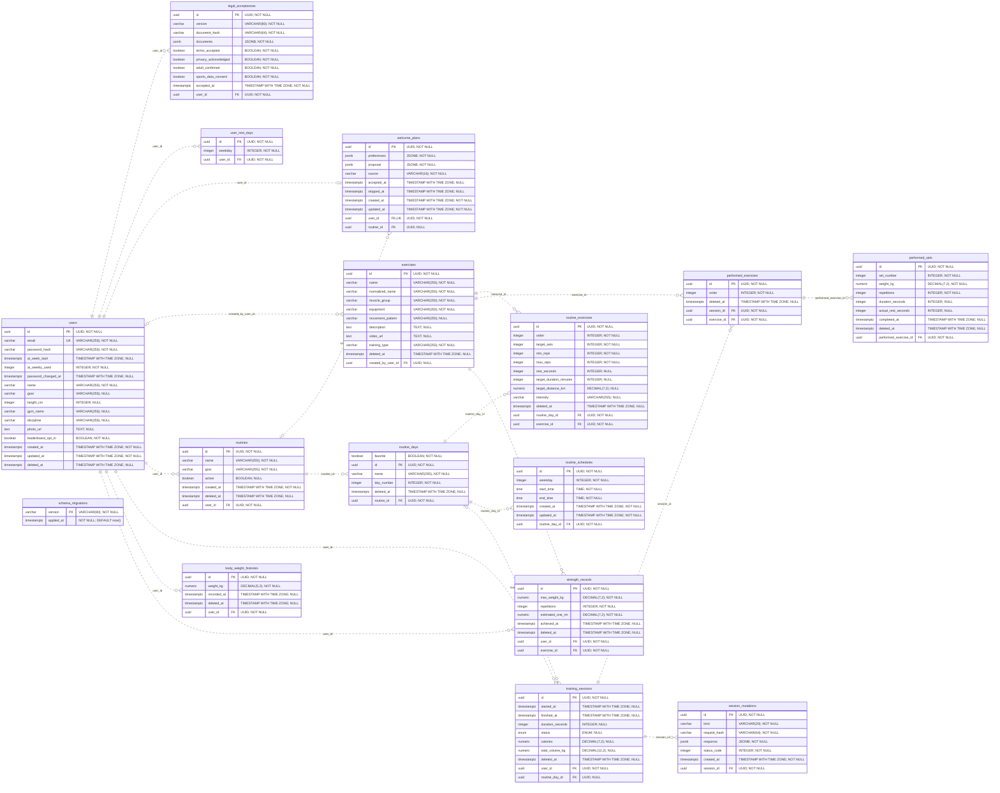

# Diagrama actualizado de Gymbro

Esquema PostgreSQL: `gymbro`. Generado desde los modelos Sequelize actuales, más la tabla técnica `schema_migrations`. Representa el esquema esperado tras aplicar las migraciones; no inspecciona ni modifica Supabase.

16 tablas, 19 claves foráneas. PK = clave primaria, FK = clave foránea, UK = unicidad de una columna. Las líneas punteadas representan relaciones no identificadoras. Un círculo permite cero; una barra indica uno; el extremo ramificado indica muchos.

## Vista completa

## Cambios recientes

- `users.ai_week_start` y `users.ai_weekly_used`: cupo de tres generaciones de IA por semana. La migración 07 agrega estos campos y la restricción entre 0 y 3.
- `users.password_changed_at`: revocación de sesiones después del cambio de contraseña. Los tokens de recuperación no se almacenan en una tabla.
- `users.leaderboard_opt_in` y `legal_acceptances`: participación en el ranking y recibos de consentimiento.
- `exercises.description` y `exercises.video_url`: instrucciones y enlace al video, sin almacenar el video.
- `welcome_plans`: conserva una propuesta por usuario. Sus preferencias y propuesta son JSONB; al aceptar se crean rutinas, ejercicios y horarios normalizados.
- `session_mutations`: recibos durables que evitan aplicar dos veces la misma operación al sincronizar entrenamientos.

## Cómo se organiza

- Planificación: `routines → routine_days → routine_exercises`. Los horarios viven en `routine_schedules`; `day_number` es un orden interno y `weekday` identifica el día semanal.
- Ejecución real: `training_sessions → performed_exercises → performed_sets`.
- `strength_records` sigue presente por compatibilidad. Las marcas personales y el ranking actuales se calculan desde `performed_sets` de sesiones completadas. El ranking no tiene una tabla propia.
- `created_by_user_id` nulo identifica un ejercicio oficial; con usuario identifica un ejercicio privado.
- `deleted_at` permite borrar lógicamente sin eliminar físicamente los registros históricos.
- `schema_migrations` es una tabla técnica independiente, sin FK.

## Unicidad compuesta

Además del email único y de una propuesta por usuario, hay índices únicos sobre:

- `user_rest_days(user_id, weekday)`.
- `routine_days(routine_id, day_number)`.
- `routine_exercises(routine_day_id, order)`.
- `routine_schedules(routine_day_id, weekday, start_time, end_time)`.
- `performed_exercises(session_id, order)`.
- `performed_sets(performed_exercise_id, set_number)`.

El catálogo también protege la unicidad del nombre normalizado mediante índices y trigger: distingue ejercicios oficiales de privados.

Para regenerar: `node tools/build-database-diagram.mjs`. El SQL entregable está en `postgres/sql`.
