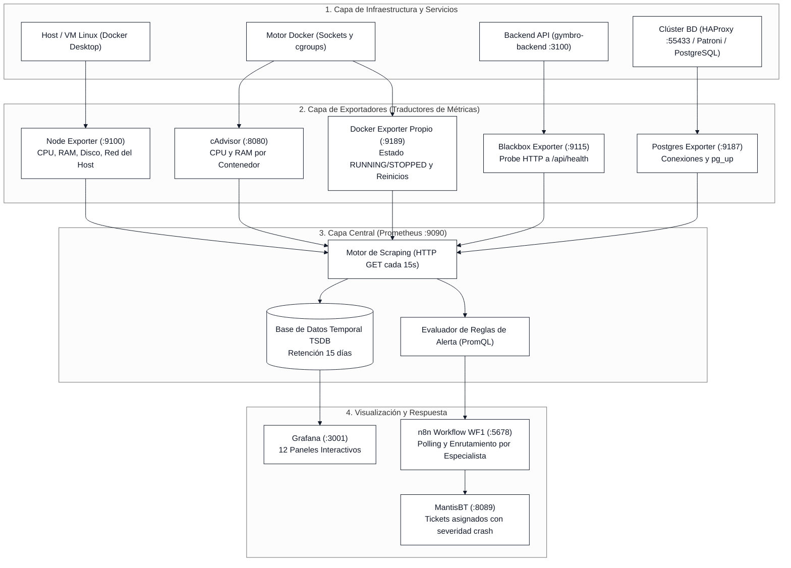
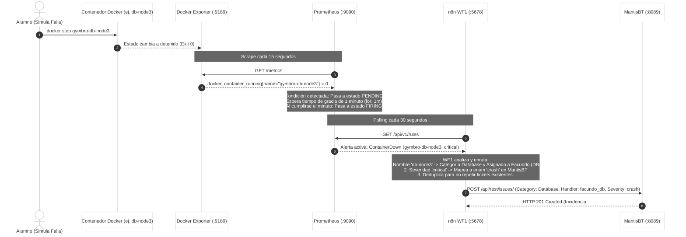

# Guía y Mapa Conceptual: Monitoreo con Prometheus y Grafana (Punto 10)
**Proyecto:** SmartGymBro · **Módulo:** `infra/monitoring` · **Responsable:** Sonia (Monitoreo e Infraestructura)

---

## 1. Arquitectura General del Sistema de Monitoreo

El sistema opera bajo un **modelo Pull**. Prometheus visita cada 15 segundos a los 5 exportadores para consultar sus métricas, las guarda en su base de datos temporal (TSDB) y las expone hacia Grafana para visualización y hacia n8n para generar alertas en MantisBT.

---

## 2. Cuadro Comparativo de Exportadores

| Exportador | Puerto | ¿Qué mide exactamente? | Justificación Técnica para la Defensa |
| :--- | :---: | :--- | :--- |
| **`node-exporter`** | `9100` | CPU, memoria RAM disponible, uso de disco y tráfico de red de la máquina virtual/host. | Provee las métricas globales del sistema operativo que exige la consigna. |
| **`cAdvisor`** | `8080` | Consumo de CPU y memoria desglosado *por cada contenedor Docker individual*. | Permite aislar qué microservicio específico está saturando el equipo. |
| **`docker-stats-exporter`** *(Script propio Python)* | `9189` | Estado de cada contenedor (1=RUNNING, 0=STOPPED) y contador real de reinicios (`RestartCount`). | **Punto clave:** cAdvisor v0.49 no expone reinicios en Docker Desktop debido al *containerd image store*. Sonia programó este script para leer directamente el socket `/var/run/docker.sock`. |
| **`blackbox-exporter`** | `9115` | Disponibilidad externa y latencia enviando peticiones HTTP GET periódicas a `/api/health`. | Mide la experiencia real del usuario: no monitorea el proceso por dentro, sino si la API responde código `HTTP 200`. |
| **`postgres-exporter`** | `9187` | Salud de la base de datos (`pg_up == 1`) y cantidad de conexiones activas e inactivas. | Monitorea la saturación y disponibilidad de PostgreSQL a través del puerto de HAProxy. |

---

## 3. Ciclo de Vida de una Alerta (De la Falla al Ticket en MantisBT)

---

## 4. Glosario Teórico para Defender ante el Profesor

* **Modelo Pull vs. Push:** En el modelo Push los servidores mandan datos a un colector central (si el colector cae, se saturan o pierden métricas). Prometheus usa **Pull**: él toma la iniciativa de consultar cada 15s. Si un contenedor muere, Prometheus se da cuenta inmediatamente porque el intento de conexión falla (`up == 0`).
* **TSDB (Time Series Database):** Base de datos optimizada exclusivamente para guardar números a lo largo del tiempo. Cada muestra almacena: `Métrica + Etiquetas (Labels) + Timestamp + Valor numérico`.
* **Gauge vs. Counter:**
  * *Gauge:* Valor que sube y baja constantemente (ej. uso de memoria RAM, temperatura, conexiones activas, estado vivo/muerto 1/0).
  * *Counter:* Valor acumulativo que únicamente se incrementa o vuelve a 0 si el servicio reinicia (ej. total de visitas recibidas, total de bytes transmitidos, contador de reinicios `RestartCount`).
* **Reglas de Alerta (Pending vs. Firing):** El parámetro `for: 1m` evita falsas alarmas ante micro-cortes. La alerta entra primero en `Pending`; si la falla persiste durante el tiempo estipulado, se transforma en `Firing` y se activa la notificación.
* **Provisioning (Infraestructura como Código):** En lugar de crear datasources y dashboards haciendo clics en la interfaz web de Grafana, se configuran archivos YAML (`datasources/prometheus.yml`) y JSON (`dashboards/gymbro-overview.json`) que se cargan automáticamente al arrancar el contenedor.

> [!NOTE]
> **Cómo responder sobre la Replicación de Base de Datos ante el Profesor:**
> En el informe inicial de Sonia se probó con una instancia base para no generar dependencias. En la integración final con el clúster de Patroni, la replicación se monitorea en tiempo real mediante la consola de estadísticas de **HAProxy** (puerto `7000`), donde se verifica que el nodo Líder esté activo en `patroni_primary` y las réplicas estén activas por streaming en `patroni_replicas` con `Lag = 0`.
